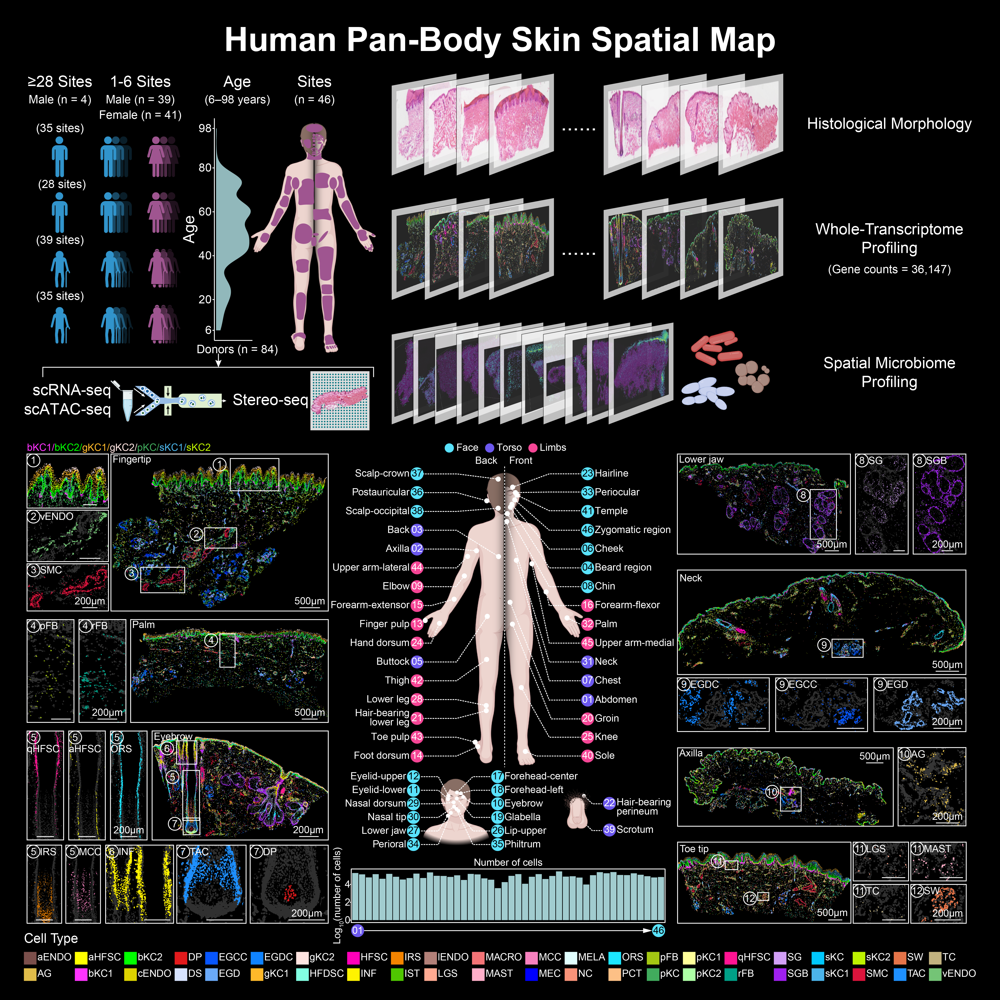

# 
Human Pan-Body Skin Spatial Map

This repository contains scripts used in the analysis of the manuscript: "**Human Pan-Body Skin Spatial Map**".

## Accessions
CNSA-Project: [CNP0010045](https://db.cngb.org/cnsa/)

Interactive website: [HSM](http://db.genomics.cn/stomics/HSM)

Github: [HSM](https://github.com/BGI-DEV-REG/HSM)

## Citation Information
If you use content from this database in your research or project, please cite the following article:

[Human Pan-Body Skin Spatial Map](article link)

## Cell segmentation workflow
We followed the method of cell segmentation described by [Wei et al.](https://www.science.org/doi/10.1126/science.abp9444)

The tools used in this study can be explored at https://github.com/BGI-DEV-REG/ARTISTA/tree/main/code/RYtools/Tools 

## Contact
guanxiong_zhang@csu.edu.cn (Guanxiong Zhang), liulongqi@genomics.cn (Longqi Liu), shizhaoji2022@163.com (Shizhao Ji), zhjuf@vip.sina.com (Jufang Zhang), xuxun@genomics.cn (Xun Xu), liji_xy@csu.edu.cn (Ji Li), chenxiangck@csu.edu.cn (Xiang Chen)
